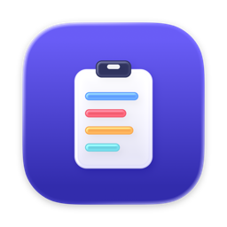

# ClipHistory

A small, free clipboard history app for macOS. It lives in the menu bar, remembers what you copy, and gives
it back with one shortcut.

- **⇧⌘V popup** with Liquid Glass styling on macOS 26 (frosted material on older versions)
- **Categories**: Links, Colors, Images, Code and Text, each with its own colour. Empty categories are hidden
- **Search**, **pin** favourites, **delete** single items (× or ⌘⌫), and **Clear History** with a confirmation
- **Images**: screenshots and copied pictures are kept as well as text
- **Paste from ClipHistory** in the Services menu (right-click → Services) inserts a pick directly into any text field
- **Desktop widget** (small, medium, large) showing your latest clips; click one to copy it
- History is kept for **1, 7 or 30 days, or forever** (⋯ menu → Keep History); at most **50** unpinned items
- **Private**: history is encrypted on disk, nothing is sent anywhere, and likely secrets are skipped. See
  [Privacy & Security](#privacy--security)

## Requirements

- macOS 14 Sonoma or later (Apple silicon or Intel)
- Swift 6 toolchain: Xcode or the Command Line Tools (`xcode-select --install`)

## Build and install

```sh
git clone <this repo>
cd ClipHistory
./build.sh
open ~/Applications/ClipHistory.app
```

`build.sh` compiles a universal app, signs it and installs it to `~/Applications`.

- If you have an Apple **Developer ID** or **Apple Development** certificate, it signs with it and includes the
  desktop widget. Choose a team with `TEAM_ID=XXXXXXXXXX ./build.sh`.
- Without a certificate the app is signed ad hoc and built **without the widget**; everything else works.

## Using it

| Action | How |
| --- | --- |
| Open the popup | ⇧⌘V, or click the menu bar icon |
| Move between cards | ← → (also ↑ ↓) |
| Switch category | Tab |
| Copy the highlighted card | Return, or click it |
| Delete the highlighted card | ⌘⌫ or × |
| Pin / unpin | the pin button on a card |
| Close | Esc, or click anywhere else |
| Clear history, Keep History, Open at Login, Quit | the ⋯ menu in the popup |

**Services menu**: right-click in a text field → Services → *Paste from ClipHistory*. If it is missing, enable it
in System Settings → Keyboard → Keyboard Shortcuts → Services → Text.

**Widget**: right-click the desktop → Edit Widgets → search for *ClipHistory*.

## Privacy & Security

ClipHistory stores what you copy, which can include sensitive things. This is exactly what it does with it.

**What is stored, and where**

| File | Contents | Protection |
| --- | --- | --- |
| `history.dat` | text history, pins, dates | AES-256-GCM encrypted |
| `images/*` | copied images | AES-256-GCM encrypted |
| `widget.json` | the up to 7 rows the desktop widget shows, shortened to 80 characters, with small thumbnails | not encrypted (see below) |

- Signed builds keep these in `~/Library/Group Containers/<TEAM_ID>.cliphistory/`; unsigned builds in
  `~/Library/Application Support/ClipHistory/`. Files are readable only by your user account.
- The encryption key is a random 256-bit key in your **login Keychain** (item "ClipHistory"). macOS lets
  ClipHistory read it without asking; any other program has to ask you first. If the key can't be read, history
  is kept in memory only and nothing is written.
- **The widget's file is not encrypted.** macOS doesn't let an unsandboxed app share a Keychain key with its widget
  without a provisioning profile, so the widget only gets the rows it puts on your desktop anyway. Don't add the
  widget if that matters to you; signed builds still write the file, unsigned builds have no widget.

**What is not stored**

- Anything a password manager marks as concealed or transient (the [nspasteboard.org](http://nspasteboard.org)
  convention used by 1Password, Bitwarden, KeePassXC and others).
- Copies made while a password manager is the front app: Passwords, Keychain Access, 1Password, Bitwarden,
  LastPass, Dashlane, KeePassXC, Enpass, NordPass, Proton Pass.
- Text that looks like a credential: private keys, GitHub/GitLab/Slack/Stripe/AWS/Google/OpenAI/Anthropic tokens,
  JWTs, and card numbers (checked with the Luhn checksum).

**Limits you should know**

- Detection is pattern-based. A plain password copied from a note, a document or a web page **will be saved**.
  Use Clear History, delete single items, or a shorter retention if you copy secrets that way.
- Encryption protects the files at rest (backups, other programs reading the folder). It does not protect against
  someone using your unlocked Mac, since the app shows your history to whoever opens it.
- Nothing is sent over the network. The app has no analytics, no update checks and no server.

**Other entry points**

- The widget opens `cliphistory://copy/<token>` links. Tokens are keyed with the encryption key, so another app or
  web page can't build a link for an item; malformed links are ignored. A valid link can only copy an item that is
  already in your history back to the clipboard.
- *Paste from ClipHistory* (Services menu) returns text only after you pick an item in the popup.

**Wiping everything**: Clear History in the app, or quit and delete the folder above and the "ClipHistory"
item in Keychain Access.

**Reporting a vulnerability**: please open a GitHub issue without exploit details and ask for a private contact,
or use GitHub's private vulnerability reporting if it is enabled on the repository.

## Development

```sh
ClipHistory.app/Contents/MacOS/ClipHistory --selftest   # runs the built-in checks
ClipHistory.app/Contents/MacOS/ClipHistory --show       # opens the popup on launch
```

| File | Contents |
| --- | --- |
| `main.swift` | menu bar app, clipboard polling, popup UI, Services handler |
| `Store.swift` | encrypted storage, Keychain key, secret detection, retention, widget snapshot, deep links |
| `SelfTest.swift` | the `--selftest` checks (temporary folder and throwaway key, never your real data) |
| `Shared.swift` | code shared with the widget: clip model, categories, thumbnails, Liquid Glass helper |
| `Widget.swift` | desktop widget |
| `build.sh` | build, sign and install |
| `AppIcon.icon` | app icon source (Icon Composer); `AppIcon.icns` is the prebuilt fallback for builds without Xcode |

## Dependencies

None. Only Apple's system frameworks (AppKit, SwiftUI, WidgetKit, CryptoKit, Security, ImageIO, Carbon,
ServiceManagement) are used; there are no packages or bundled third-party assets.

## License

[MIT](LICENSE). The software is provided as is, without warranty; see the license for the full terms.
